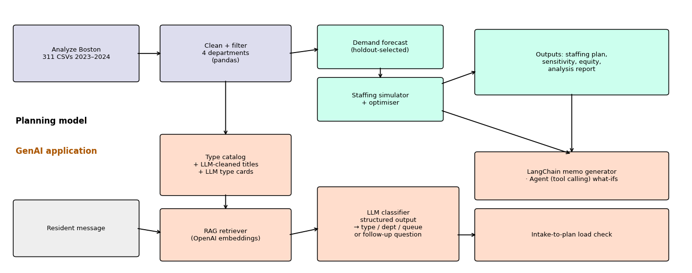

# Boston 311 Crew Staffing Plan for 2025

IE 5374, Module 7 Hackathon. Topic: Staffing Boston's 311 City Service Teams.

Team: Sanika Chaudhari, Sailee Choudhari, Ankit Raj Sharma

We used two years of real Boston 311 requests (2023 and 2024) to plan how many field crews four city departments need in each month of 2025: Public Works, Transportation, Parks & Recreation, and Inspectional Services. On top of the plan we built a 311 intake assistant. A resident types a problem in plain English, and the assistant picks the matching request type, department and queue from the city's real list, or asks a follow-up question if the message is too vague.

Everything is in one notebook: `IE5374_Hackathon_Boston311.ipynb`.

## What's in the notebook

| Section | What it does |
|---|---|
| 1–2 | Loads the 311 data, keeps the four departments, and checks our 2024 counts and on-time rates against the brief (they match exactly) |
| 3 | Forecasts monthly requests for 2025. We tested three simple methods on Sep–Dec 2024 and used the one with the lowest error |
| 4 | Simulates each department month by month and searches for the cheapest crew plan under the brief's hiring, release and penalty rules |
| 5 | Sensitivity: demand ±20%, a February snowstorm, a July heat wave, and what happens if fewer requests need a crew visit |
| 6 | Neighborhood differences in on-time rates, and requests logged by city employees vs residents |
| 7 | The intake assistant and its evaluation on 42 test messages |
| 8 | Links the assistant to the plan: routes messages to departments, writes a staffing memo per department, and answers what-if questions by calling the simulator |
| 9 | Summary of results, generated from the computed numbers |

GenAI techniques used: API calls and prompt engineering throughout, retrieval over the request-type catalog (RAG, OpenAI embeddings), Pydantic structured output for the classifier and the data-cleaning steps, a LangChain chain for the memos, and tool calling for the what-if agent.

## Architecture

The planning side (top) goes from raw CSVs to a forecast, then to the simulator and optimiser. The GenAI side (bottom) builds a catalog of real request types from the same data, retrieves the closest types for a message, and lets the LLM choose among them. The memo generator and the what-if agent read from the staffing model, so the plan is what the LLM explains rather than something it makes up.

## Results

**Staffing plan.** The recommended plan costs about $13.8M for the year. Keeping January's crew levels all year would cost $18.1M, mostly because of overdue penalties ($5.6M, down to $0.4M under our plan). The recommended plan doesn't release any permanent crews.

| Department | Jan crews | Plan | Modelled on-time |
|---|---|---|---|
| Public Works | 50 | Hire 1 in April and 1 in May, giving 52 from June | 92% |
| Transportation | 18 | Hire 3 in January and 2 in February, giving 23 from March | 94% |
| Parks & Recreation | 10 | Hire 3 in April and 1 in May (14 by June), plus 1–2 seasonal crews April–July | 85% |
| Inspectional Services | 16 | Hire 1 in February and 1 in March, giving 18 from April | 85% |

The full month-by-month table with the action for each month is in section 4 and in `outputs/staffing_plan_2025.csv`.

**Why there are two plans.** Following the brief's costs alone produces some odd answers. An Inspectional Services crew costs about $139 per request it closes, which is more than the maximum $120 penalty for a late request. So on cost alone it never pays to hire there. For Parks, 57% of requests have a 365-day target, so lateness is rarely penalised, and the cheapest plan lets go of all ten crews. We therefore added a service floor: modelled on-time has to stay at 85% or above in every department. That plan costs about $165k more than the pure cost plan and is the one we recommend.

**Sensitivity.** A 20% jump in demand is the real risk. If the plan can't react, Transportation's on-time rate drops to about 21% and Public Works' to about 40%. Re-planning for the higher demand would cost about $8.8M less than riding it out. A snowstorm costs much less (about $450k could be saved by re-planning), and the heat wave scenario is mostly absorbed by the existing plan.

**Equity.** Transportation has the widest gap between neighborhoods: 36% on time in West Roxbury vs 62% in the best neighborhood. For Inspectional Services, Greater Mattapan (62%) and East Boston (65%) are the lowest.

**Intake assistant.**

| Metric | Result |
|---|---|
| Correct request type | 86% (31 of 36). Retrieval alone gets 47% |
| Correct department | 92% |
| Right answer among the 8 retrieved candidates | 97% |
| Follow-up question on vague messages | 6 of 6 |
| Unnecessary follow-ups on clear messages | 0 |

Three of the five errors are arguably fine answers, for example "Chronic Dampness/Mold" instead of "Unsatisfactory Living Conditions" for a mold complaint. The city's categories overlap. The two real errors are a light pole near a park sent to Parks instead of Public Works, and park litter sent to "Empty Litter Basket" because the correct type wasn't retrieved.

## Key assumptions

- Crew capacities, costs and January crew levels are taken exactly from the brief.
- Every in-scope request uses crew time. Section 4.1 shows this makes the model stricter than what actually happened in 2024, so the absolute on-time numbers are conservative. Section 5 reruns the plan at 80% and 60%.
- Crews work the oldest requests first. Target dates follow each department's real 2024 pattern. Requests without a target date are never counted as overdue.
- A request is overdue ($20) if it's still open at the end of the month it was due, and costs another $100 if it's still open a month after that. This is a monthly approximation of day-level target dates.
- A new crew is paid during its training month. A released crew works its notice month. January 2025 is fixed at the brief's crew levels.
- Requests still open on 31 December cost $20 each. This is our assumption, so the optimiser can't save money by leaving a backlog at year end.

## Limitations

- Monthly steps hide spikes within a month, such as a snowstorm that lasts a few days.
- The test set is small (42 messages) and we wrote it ourselves. The gold labels were checked against the real request types in the data.
- The optimiser is a local search, not a guaranteed optimum. We run it from several starting points and keep the best.
- The LLM memos (section 8.2) contain some mistakes, even though the prompt tells the model to use only the numbers it's given. The Transportation memo reads the re-planning figure the wrong way round (calls a $4.3M saving a cost increase), and says requests exceed capacity from May to October when July and August are actually under capacity. The Public Works memo's saving is off by $1,000. We kept them as generated: they're drafts for a person to check, not final numbers. The tables in sections 4–5 are the source of truth.

## How to run

1. Download "311 Service Requests - 2023" and "- 2024" from [Analyze Boston](https://data.boston.gov/dataset/311-service-requests) and put them in a `data/` folder. Our files are named `lagan_311_open_data_2023_rvsd3.csv` and `lagan_311_open_data_2024_rvsd3.csv`. If yours are named differently, update `FILES` in section 1.
2. Open the notebook in Google Colab and add your OpenAI key as a Colab Secret called `OPENAI_API_KEY`.
3. In section 7, set `RUN_UI = False` (the chat UI cell keeps running and would stop *Run all* there), then use Runtime → Run all.
4. To try the chat UI, set `RUN_UI = True` and run that cell on its own. It prints a temporary public link.

The data files are not in this repo because each one is over GitHub's 100 MB limit. The first run makes about 300 LLM calls. Title labels and type descriptions are cached in `outputs/`, so later runs are cheaper.

Packages: see `requirements.txt` (openai, langchain-openai, langchain-core, pydantic, pandas, numpy, matplotlib, scikit-learn, scipy, pyarrow, and gradio for the chat UI).

## Team contributions

| Member | Contributions |
|---|---|
| Ankit Raj Sharma | Data loading and cleaning, checking our counts against the brief, exploratory analysis, demand forecast and backtest (sections 1–3), neighborhood equity and employee vs resident analysis (section 6), Gradio chat UI and demo video |
| Sailee Choudhari | Staffing simulator and optimiser, break-even economics, model check against 2024 (section 4), sensitivity analysis (section 5), LangChain memo generator (section 8.2), results summary and README |
| Sanika Chaudhari | Request-type catalog and LLM title cleaning, embedding retrieval, intake classifier with structured output (sections 7.1–7.6), test set and evaluation (section 7.7), intake-to-plan check and what-if agent (sections 8.1, 8.3), architecture diagram |

All three of us reviewed every section, tested the chat UI, and worked through the final run together.